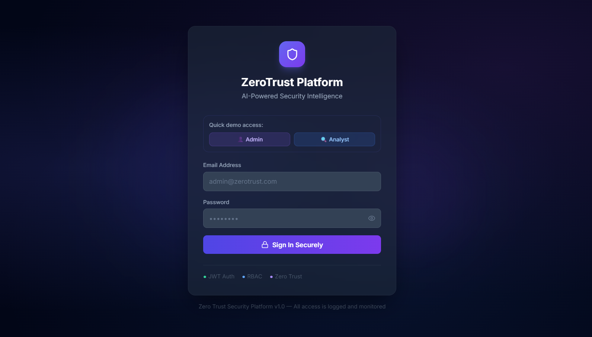

# 🛡️ SYVORA — Zero Trust API Security & Real-Time Threat Monitoring

> Enterprise-grade Zero Trust Banking & API Security Platform built with Spring Boot 3.3, Java 21, PostgreSQL 16, Redis 7, React 18, and Google Gemini AI. Features context-aware ABAC, AES-256-GCM field encryption, tamper-evident cryptographic audit logging, distributed rate limiting, real-time SSE threat streaming, and an automated SOC incident response lifecycle.

[](https://openjdk.org/)
[](https://spring.io/projects/spring-boot)
[](https://www.postgresql.org/)
[](https://redis.io/)
[](https://react.dev/)
[](https://www.typescriptlang.org/)
[](https://www.docker.com/)
[](https://github.com/features/actions)
[](LICENSE)

---

## 📑 Table of Contents
- [Executive Overview](#-executive-overview)
- [System Architecture](#-system-architecture)
- [Application Screenshots](#-application-screenshots)
- [Project Structure](#-project-structure)
- [Core Security Capabilities](#-core-security-capabilities)
  - [1. Context-Aware ABAC & Authorization Matrix](#1-context-aware-abac--authorization-matrix)
  - [2. AES-256-GCM Field-Level Encryption & Backfill](#2-aes-256-gcm-field-level-encryption--backfill)
  - [3. Tamper-Evident Monotonic Audit Hash Chain](#3-tamper-evident-monotonic-audit-hash-chain)
  - [4. Distributed Token Revocation & Fail-Closed Redis](#4-distributed-token-revocation--fail-closed-redis)
  - [5. Bounded Stream Threat Inspection Engine](#5-bounded-stream-threat-inspection-engine)
  - [6. Automated SOC Incident Management Lifecycle](#6-automated-soc-incident-management-lifecycle)
- [Database Architecture & Flyway Migrations](#-database-architecture--flyway-migrations)
- [Technology Stack & Architectural Rationale](#-technology-stack--architectural-rationale)
- [Automated Verification & Test Evidence](#-automated-verification--test-evidence)
- [Local Quick Start Guide](#-local-quick-start-guide)
- [Environment Configuration](#-environment-configuration)
- [API Demonstration & Verification Scripts](#-api-demonstration--verification-scripts)
- [Security Model, Threat Assumptions & Limitations](#-security-model-threat-assumptions--limitations)
- [Repository Governance & Documentation](#-repository-governance--documentation)
- [Resume-Ready Project Impact Summary](#-resume-ready-project-impact-summary)

---

## 🎯 Executive Overview

SYVORA is designed around the core Zero Trust tenet: **"Never trust, always verify."** Traditional perimeter security models assume everything inside the network is trustworthy. SYVORA assumes breach, enforcing strict mutual verification, contextual risk-based policies, cryptographic non-repudiation, and proactive automated threat containment on every single API transaction.

```
                           +------------------------------------------+
                           |          Client / Attacker / UI          |
                           +--------------------+---------------------+
                                                | HTTP / SSE
                                                v
                           +------------------------------------------+
                           |           Nginx Reverse Proxy            |
                           |   (Bufferless SSE / Rate-Limit Proxy)    |
                           +--------------------+---------------------+
                                                |
                                                v
                +--------------------------------------------------------------+
                |                    Spring Security Filter Chain               |
                |                                                              |
                | 1. JwtAuthenticationFilter: Bearer Token + Redis Denylist   |
                | 2. RateLimitingFilter: Tiered Sliding Window (Redis Token)  |
                | 3. ThreatInspectionFilter: Bounded Request Stream (RFC 9110) |
                +--------------------------------------------------------------+
                                                |
                                                v
                +--------------------------------------------------------------+
                |                  Context-Aware ABAC Enforcer                 |
                |     Evaluates: Subject, Action, Resource, Environmental Risk |
                +--------------------+---------------------+-------------------+
                                     |                     |
                                     v                     v
                  +----------------------+     +----------------------+
                  |  Core Banking Domain |     |  SOC Threat Engine   |
                  |  - Idempotent Txns   |     |  - Incident Stepper  |
                  |  - Account Balances  |     |  - Timeline Audit    |
                  |  - AES-256-GCM TaxId |     |  - Gemini AI Triage  |
                  +----------+-----------+     +-----------+----------+
                             |                             |
                             +--------------+--------------+
                                            |
                                            v
                +--------------------------------------------------------------+
                |              AuditService (Pessimistic Anchor)               |
                |   Monotonic Sequencing, V2 Length-Value Canonical Serialization |
                |                   SHA-256 Back-Linked Chain                  |
                +---------------------------+----------------------------------+
                                            |
                                            v
                                +-----------------------+
                                |     PostgreSQL 16     |
                                |  Triggers: Immutable  |
                                |  Audit Logs & Timeline|
                                +-----------------------+
```

---

## 🏗️ System Architecture

The Zero Trust Security Platform follows a layered architecture separating authentication, threat detection, audit logging, AI-powered security intelligence, and secure data persistence into dedicated components.

<p align="center">
  
</p>

### Multi-Tier Component Topology
1. **Frontend Presentation (React 18, TypeScript, TailwindCSS):**
   - Real-time SOC dashboard, Threat Event Monitor, Incident Management Drawer with state transition stepper, Audit Chain Verifier, and Gemini AI forensic analysis.
   - Served via Nginx 1.27 Alpine with strict security headers (`X-Frame-Options: DENY`, `X-Content-Type-Options: nosniff`, `CSP`) and unbuffered SSE reverse proxying.
2. **API Security Gateway (Spring Boot 3.3, Spring Security 6):**
   - Stateless JWT authentication filter reading from `Authorization: Bearer <token>`.
   - Redis token denylist integration with fail-closed semantics for revoked credentials.
   - Distributed sliding-window rate limiting per IP and authenticated subject with memory-bounded fallback.
   - Bounded stream inspection filter buffering a strict 64 KB window for signature evaluation.
3. **Application Domain & Authorization:**
   - Context-aware ABAC engine evaluating subject attributes, resource classification, action verbs, and dynamic environment context.
   - Double-entry ledger with deterministic UUID-ordered row-level pessimistic locking (`SELECT ... FOR UPDATE`) and persistence context entity refresh preventing lost updates and deadlocks.
   - Distributed idempotency engine with deterministic SHA-256 payload hashing and collision detection.
4. **Persistence & Cryptographic Integrity:**
   - PostgreSQL 16 relational database with Flyway migration management (V1 through V9).
   - Monotonically sequenced SHA-256 audit hash chain anchored by pessimistic locking.
   - In-database immutability enforced by PostgreSQL PL/pgSQL triggers (`trg_prevent_audit_log_tamper`, `trg_prevent_incident_deletion`).

---

## 📸 Application Screenshots

### 🔐 Login Page

<p align="center">
  
</p>

The platform provides secure authentication using JWT-based login with Role-Based Access Control (RBAC). Users can quickly authenticate with demo credentials or access secure endpoints.

---

## 📂 Project Structure

```text
zero-trust-platform/
├── backend/
│   ├── src/main/java/com/zerotrust/
│   │   ├── config/              # Security filter chain, Redis config, Flyway config
│   │   ├── controller/          # REST APIs (Auth, Customer, Txn, Threat, Audit, Incident)
│   │   ├── dto/                 # Request/response records & payload schemas
│   │   ├── entity/              # JPA entities (Customer, Account, Txn, AuditLog, Incident)
│   │   ├── exception/           # Global RFC 7807 ProblemDetail exception handler
│   │   ├── repository/          # Spring Data JPA repositories with pessimistic locking
│   │   ├── security/            # JWT provider, ABAC enforcer, Crypto converters
│   │   ├── service/             # Banking domain, Threat engine, Incident lifecycle
│   │   └── threat/              # Bounded stream inspection filter, signature regexes
│   └── src/main/resources/
│       ├── application.yml      # Base Spring Boot configuration
│       └── db/migration/        # Flyway migrations V1 through V9
├── frontend/
│   ├── src/
│   │   ├── api/                 # Axios clients with automatic token refresh
│   │   ├── components/          # Reusable UI components & navigation
│   │   ├── pages/               # Dashboard, Customers, Txns, Threats, Incidents, Audit
│   │   ├── store/               # State management (Zustand)
│   │   └── types/               # TypeScript interface contracts
│   └── nginx.conf               # Hardened reverse proxy & bufferless SSE config
├── docs/                        # Architecture, database schema, and security documentation
│   ├── architecture.md
│   ├── database.md
│   └── security.md
├── .github/workflows/
│   └── ci.yml                   # Automated CI: Backend, Frontend, Docker & Service Containers
├── docker-compose.yml           # Multi-container orchestration (Backend, Frontend, Postgres, Redis)
└── .env.example                 # Validated environment configuration template
```

---

## 🔐 Core Security Capabilities

### 1. Context-Aware ABAC & Authorization Matrix
SYVORA extends standard RBAC with a dynamic Attribute-Based Access Control (ABAC) engine. Access decisions are evaluated at runtime by checking four vector dimensions:
$$\text{Decision} = f(\text{Subject}, \text{Resource}, \text{Action}, \text{Environment Context})$$

- **Subject Attributes:** Identity, assigned security roles (`ROLE_ADMIN`, `ROLE_SECURITY_ANALYST`, `ROLE_AUDITOR`, `ROLE_EMPLOYEE`), branch ID, clearance tier.
- **Resource Attributes:** Target entity type (`CUSTOMER`, `ACCOUNT`, `TRANSACTION`, `AUDIT_LOG`, `INCIDENT`), assigned employee owner, sensitivity classification (`CONFIDENTIAL`, `RESTRICTED`), risk tier (`LOW`, `MEDIUM`, `HIGH`, `CRITICAL`).
- **Action Verbs:** `READ`, `WRITE`, `EXECUTE_TRANSACTION`, `VIEW_UNMASKED_SSN`, `EXPORT_FORENSICS`, `TRANSITION_INCIDENT`.
- **Environment Context:** Client IP, device fingerprint, geographic location, dynamic threat level, business-hour window.

#### Policy Enforcement Matrix
| Role | Customer Data | Financial Transactions | Sensitive Tax ID / SSN | Threat Incidents | Audit Hash Chain |
| :--- | :--- | :--- | :--- | :--- | :--- |
| `ROLE_ADMIN` | Full Access | Full Access | Full Access | View & Triage | View & Verify Anchor |
| `ROLE_SECURITY_ANALYST` | Read Assigned | Denied | Masked (`***-**-9999`) | Full Lifecycle (Open $\rightarrow$ Closed) | View & Verify Anchor |
| `ROLE_AUDITOR` | Read Only | Read Only | Masked | Read Only | Full Chain Verification |
| `ROLE_EMPLOYEE` | Assigned Branch Only | Execute Transfer | Denied | Denied | Denied |

---

### 2. AES-256-GCM Field-Level Encryption & Backfill
All Personally Identifiable Information (PII) — including government-issued Tax IDs and synthetic SSNs — is encrypted at rest using AES-256 in Galois/Counter Mode (GCM):
- **Authenticated Encryption with Associated Data (AEAD):** Each encrypted field produces a 12-byte cryptographically secure random IV, 16-byte GCM authentication tag, and ciphertext. The entity ID is passed as Additional Authenticated Data (AAD) to prevent ciphertext transplant attacks across records.
- **Key Derivation (PBKDF2/HKDF):** Master encryption keys are never stored in plaintext; keys are derived using PBKDF2 with HMAC-SHA256 (600,000 iterations).
- **Deterministic Field Backfill:** A backward-compatible migration detects legacy plaintext customer records on startup, encrypts them safely in batches using Flyway and JPA converters, and marks the backfill migration complete without service downtime.

---

### 3. Tamper-Evident Monotonic Audit Hash Chain
Audit records form an immutable, append-only cryptographic hash chain:
$$H_n = \text{SHA-256}\Big(\text{V2} \parallel \text{LV}(\text{seq}_n) \parallel \text{LV}(H_{n-1}) \parallel \text{LV}(\text{actor}) \parallel \text{LV}(\text{action}) \parallel \text{LV}(\text{payloadHash})\Big)$$

- **Length-Value (LV) Canonical Encoding:** All field inputs are encoded using explicit length-value prefixes (`len:value`) to eliminate delimiter injection and hash collision attacks.
- **Pessimistic Anchor Locking:** Chain head sequence allocation and previous hash linking are guarded by a row-level pessimistic write lock on the `audit_chain_anchor` table, preventing concurrent transaction forks.
- **Anchor Head-Truncation Detection:** Verifying through the end of the chain compares the maximum log sequence and hash against the anchor. Deleting the latest record to conceal an attack triggers `HEAD_TRUNCATION_DETECTED`.
- **Database Engine Immutability:** A PL/pgSQL trigger (`trg_prevent_audit_log_tamper`) blocks any `UPDATE` or `DELETE` at the database level.

---

### 4. Distributed Token Revocation & Fail-Closed Redis
- **Distributed Denylist:** When a user logs out, rotates a refresh token, or triggers an automated incident response, the JWT JTI (JWT ID) is placed in Redis with a TTL matching token expiration.
- **Fail-Closed Resilience:** In the event of a Redis outage or network partition, the security filter fails closed on sensitive financial and customer endpoints (`HTTP 503 / 401`), preventing revoked tokens from bypassing security during infrastructure disruptions.

---

### 5. Bounded Stream Threat Inspection Engine
- **Memory-Safe Stream Buffering:** Implemented via `CachedBodyHttpServletRequest` with a strict 64 KB memory cap independent of client-supplied `Content-Length` headers, defeating memory exhaustion DoS attacks.
- **HTTP 413 Early Termination:** Inbound requests with declared or actual payloads exceeding 64 KB are rejected immediately with `413 Payload Too Large`.
- **Compiled Threat Signatures:** Real-time regex inspection for SQL Injection (tautologies, UNION, DROP, stacked queries), Cross-Site Scripting (XSS), Path Traversal (`../`), and Command Injection.
- **Deterministic Incident Escalation:** Detected threats trigger an immediate security event, asynchronous forensic persistence, and push notification over SSE.

---

### 6. Automated SOC Incident Management Lifecycle
- **Incident State Machine:** Formal transitions governed by strict transition rules:
  $$\text{OPEN} \longrightarrow \text{INVESTIGATING} \longrightarrow \text{CONTAINED} \longrightarrow \text{RESOLVED} \longrightarrow \text{CLOSED}$$
- **Immutable Timeline:** Every state change, forensic annotation, and analyst assignment appends an immutable timeline event protected by PostgreSQL trigger `trg_prevent_incident_deletion`.
- **AI-Powered Triage:** Integrated with Google Gemini 1.5 to generate root-cause explanations and mitigation recommendations for active incidents.

---

## 🗄️ Database Architecture & Flyway Migrations

The database schema is evolved deterministically across 9 versioned Flyway migrations:

| Migration | Purpose & Schema Components |
| :--- | :--- |
| `V1__init_schema.sql` | Users, roles, user_roles join table, audit_logs base table. |
| `V2__seed_roles_and_admin.sql` | Seed base RBAC roles and administrative accounts with BCrypt hashes. |
| `V3__threat_events_schema.sql` | Threat monitoring tables: `threat_events` with forensic metadata. |
| `V4__banking_domain_schema.sql` | Customer accounts, double-entry financial `transactions`, account types. |
| `V5__idempotency_schema.sql` | Persistent `idempotency_records` table with request hash and response storage. |
| `V6__encrypt_sensitive_customer_fields.sql` | Encryption metadata, customer risk tiers, synthetic tax ID columns. |
| `V7__pgcrypto_and_audit_hash_chain.sql` | Monotonic audit chain sequence, hash verification functions, pgcrypto support. |
| `V8__audit_chain_and_incidents.sql` | Incident response tables (`incidents`, `incident_timeline`), `audit_chain_anchor`, PL/pgSQL immutability triggers. |
| `V9__harden_immutability_triggers.sql` | Hardened trigger functions with strict PostgreSQL superuser exception handling. |

---

## 🛠️ Technology Stack & Architectural Rationale

| Layer | Component | Version | Rationale |
| :--- | :--- | :--- | :--- |
| **Language** | Runtime | Java 21 LTS | Pattern matching, records, sealed interfaces, and robust memory safety. |
| **Framework** | Application Core | Spring Boot 3.3.2 | Production-ready actuators, dependency injection, and battle-tested Spring Security 6. |
| **Relational DB** | Primary Storage | PostgreSQL 16 | ACID transactions, row-level locking (`FOR UPDATE`), PL/pgSQL triggers, and JSONB. |
| **Distributed Cache**| Rate Limiting & Denylist | Redis 7.4 (Lettuce) | High-throughput distributed token-bucket rate limiting and atomic token revocation. |
| **Frontend** | Single-Page Application | React 18.3, TypeScript 5.5 | Type-safe interactive SOC dashboard, Lucide icons, and TailwindCSS styling. |
| **Reverse Proxy** | Edge Gateway | Nginx 1.27 Alpine | HTTP security headers, TLS termination, and unbuffered SSE reverse proxying. |
| **AI Engine** | Forensic Assistant | Google Gemini 1.5 Pro/Flash | Contextual threat analysis, automated triage, and mitigation generation. |

---

## 🧪 Automated Verification & Test Evidence

SYVORA is backed by a comprehensive automated test suite spanning unit, security, integration, concurrency, and cryptographic verification.

```text
[INFO] Results:
[INFO] 
[INFO] Tests run: 143, Failures: 0, Errors: 0, Skipped: 0
[INFO] 
[INFO] ------------------------------------------------------------------------
[INFO] BUILD SUCCESS
[INFO] ------------------------------------------------------------------------
```

### Test Suite Breakdown

| Category | Test Suite Class | Tests Run | Passed | Focus Areas |
| :--- | :--- | :---: | :---: | :--- |
| **Cryptography** | `AuditHasherTest` | 5 | 5 | Length-Value V2 collision resistance, null vs empty, Unicode, V1 fallback |
| **Audit Integrity** | `AuditChainIntegrityIntegrationTest` | 7 | 7 | Sequence continuity, tampering detection, sequence gaps, broken links, anchor head truncation, concurrent writes (50 threads) |
| **Incident SOC** | `IncidentManagementIntegrationTest` | 5 | 5 | Lifecycle state transitions, invalid transition rejection, auto-promotion, deduplication |
| **Encryption** | `CustomerEncryptionIntegrationTest` | 3 | 3 | Legacy plaintext backfill, unmasked employee ABAC denial, GCM round-trip |
| **Threat Engine** | `ThreatInspectionIntegrationTest` | 10 | 10 | Bounded requests, SQLi, XSS, Path Traversal, Command Injection, 413 rejection |
| **PostgreSQL 16 & Concurrency** | `PostgresConcurrencyIntegrationTest` | 6 | 6 | Live PostgreSQL 16 container, Flyway V1–V9 verification, deadlock-free opposing transfers, pessimistic row locks |
| **Financial Concurrency** | `FinancialConcurrencyAndRollbackIntegrationTest` | 3 | 3 | Atomic transfers, balance preservation under opposite concurrent transfers, overdrawing prevention |
| **Idempotency** | `IdempotencyIntegrationTest` | 4 | 4 | Payload conflict detection, concurrent duplicate rejection, replay caching |
| **Account & Txn Safety** | `AccountAndTransactionServiceTest` | 7 | 7 | Atomic transfers, entity refresh persistence exception propagation, ownership denial |
| **Filter Hardening** | `ThreatFilterRemediationTest` | 4 | 4 | RFC 9110 413 response, persistence failure block, duplicate filter prevention |
| **ABAC & RBAC** | `AbacPolicyEnforcerTest` | 10 | 10 | Contextual risk-based denial, employee branch isolation, view masking |
| **Security** | `RoleBasedAccessControlTest` | 6 | 6 | Route permissions, role enforcement, unauthorized access rejection |
| **Controllers & Actuators** | `IncidentControllerTest`, `AuditControllerTest`, etc. | 62 | 62 | REST endpoints, DTO sanitization, SSE streams, pagination |
| **Distributed Redis 7** | `RedisSecurityIntegrationTest` | 11 | 11 | Live Redis 7 container: multi-tier rate limiting, brute-force mitigation, fail-closed token revocation |
| **Total (CI Automated)** | | **143** | **143** | **0 Failures, 0 Errors, 0 Skipped** |

---

## 🚀 Local Quick Start Guide

### Prerequisites
- Java 21 LTS (`java -version`)
- Maven 3.9+ (`mvn -version`)
- Node.js 20+ and npm (`node -v`)
- Docker Desktop or standalone Docker daemon

### Option 1: Docker Compose (Recommended Full-Stack)
```bash
# 1. Clone repository
git clone https://github.com/saipranav22-commits/zero-trust-platform.git
cd zero-trust-platform

# 2. Configure environment
cp .env.example .env

# 3. Generate a secure 256-bit JWT secret, AES encryption key, and database password
# On Linux/macOS:
export POSTGRES_PASSWORD=$(openssl rand -base64 16)
export JWT_SECRET=$(openssl rand -base64 32)
export ENCRYPTION_KEY=$(openssl rand -base64 32)

# On Windows PowerShell (Cryptographically Secure CSPRNG):
$env:POSTGRES_PASSWORD = $( $b = [byte[]]::new(16); [System.Security.Cryptography.RandomNumberGenerator]::Create().GetBytes($b); [Convert]::ToBase64String($b) )
$env:JWT_SECRET = $( $b = [byte[]]::new(32); [System.Security.Cryptography.RandomNumberGenerator]::Create().GetBytes($b); [Convert]::ToBase64String($b) )
$env:ENCRYPTION_KEY = $( $b = [byte[]]::new(32); [System.Security.Cryptography.RandomNumberGenerator]::Create().GetBytes($b); [Convert]::ToBase64String($b) )

# 4. Launch all services
docker compose up --build
```
The platform will be live at:
- **Frontend Dashboard:** `http://localhost:3000`
- **Backend API & Actuator:** `http://localhost:8080`
- **Interactive Swagger UI:** `http://localhost:8080/swagger-ui.html`

### Option 2: Local Development
```bash
# 1. Run backend tests (uses embedded H2 in PostgreSQL dialect mode)
cd backend
mvn clean test

# 2. Start PostgreSQL 16 & Redis 7 via Compose
docker compose up postgres redis -d

# 3. Run Spring Boot Application
mvn spring-boot:run

# 4. In a separate terminal, launch Frontend
cd ../frontend
npm install
npm run dev
```

---

## ⚙️ Environment Configuration

All configurable environment properties with production-grade defaults:

| Variable | Default Value | Description |
| :--- | :--- | :--- |
| `POSTGRES_HOST` | `localhost` | PostgreSQL 16 host address |
| `POSTGRES_PORT` | `5432` | PostgreSQL port |
| `POSTGRES_DB` | `zerotrust_db` | Database name |
| `POSTGRES_USER` | `zerotrust` | Database username |
| `POSTGRES_PASSWORD` | `zerotrust123` | Database password |
| `REDIS_HOST` | `localhost` | Redis server host |
| `REDIS_PORT` | `6379` | Redis port |
| `JWT_SECRET` | *(Required in Prod)* | 256-bit Base64 signing secret for JWT access tokens |
| `ENCRYPTION_KEY` | *(Required in Prod)* | 256-bit Base64 master key for AES-256-GCM field encryption |
| `GEMINI_AI_ENABLED` | `false` | Set to `true` to activate Gemini AI incident explanation |
| `GEMINI_API_KEY` | `""` | Google Gemini API key from Google AI Studio |
| `APP_SEED_DEMO_DATA` | `false` | Seeding synthetic demo users (`true` in dev only; blocked in `prod`) |

---

## 📡 API Demonstration & Verification Scripts

### 1. Authenticate as Security Analyst
```bash
curl -X POST http://localhost:8080/api/auth/login \
  -H "Content-Type: application/json" \
  -d '{"email":"analyst@zerotrust.com","password":"Analyst@123"}'
```

### 2. Verify Audit Hash Chain Continuity
```bash
curl -X GET http://localhost:8080/api/audit/chain/verify \
  -H "Authorization: Bearer <TOKEN>"
```
*Expected Response:*
```json
{
  "success": true,
  "data": {
    "chainValid": true,
    "totalRecordsVerified": 142,
    "firstSequence": 1,
    "lastSequence": 142,
    "failureReason": "Audit chain intact and verified successfully"
  }
}
```

### 3. Submit Controlled Attack to Trigger Auto-Incident Creation
```bash
curl -X POST http://localhost:8080/api/customers \
  -H "Authorization: Bearer <TOKEN>" \
  -H "Content-Type: application/json" \
  -d '{"name":"Attacker","email":"test@inject.com","taxId":"123\" OR 1=1--"}'
```
*Expected Response:*
`403 Forbidden` (Threat blocked by `ThreatInspectionFilter`). An automated incident is generated and dispatched via SSE to connected analysts.

---

## 🛡️ Security Model, Threat Assumptions & Limitations

1. **Threat Model:** SYVORA protects against external network adversaries, malicious compromised user accounts, rogue API clients, and offline database tampering.
2. **Database Superuser Boundary:** The PostgreSQL immutability triggers (`trg_prevent_audit_log_tamper`, `trg_prevent_incident_deletion`) prevent tampering from any application role. However, a root PostgreSQL DBA (`postgres` superuser) can disable triggers (`ALTER TABLE audit_logs DISABLE TRIGGER ALL`). For non-repudiation against compromised DBAs, periodic cryptographic checkpoints must be exported to external WORM storage.
3. **Single-Node SSE:** The current SSE implementation broadcasts notifications across active client connections attached to the running instance. Clustered multi-replica deployments should enable Redis Pub/Sub to fan out notifications across instances.

---

## 📜 Repository Governance & Documentation

Comprehensive supplementary guides and open-source governance policies:

- **Architecture Deep-Dive:** [`docs/docs/architecture.md`](docs/docs/architecture.md)
- **Database Schema & Migrations:** [`docs/database.md`](docs/database.md)
- **Security Policy & Reporting:** [`SECURITY.md`](SECURITY.md) and [`docs/security.md`](docs/security.md)
- **Contribution Guidelines:** [`CONTRIBUTING.md`](CONTRIBUTING.md)
- **Code of Conduct:** [`CODE_OF_CONDUCT.md`](CODE_OF_CONDUCT.md)
- **Changelog & Release Notes:** [`CHANGELOG.md`](CHANGELOG.md)
- **License:** [MIT License](LICENSE)

---

## 💼 Resume-Ready Project Impact Summary

- **Enterprise Zero Trust Architecture:** Architected and engineered a comprehensive Spring Boot 3.3 and Java 21 modular monolith enforcing context-aware ABAC, dynamic risk scoring, and zero-trust verification on every request.
- **Cryptographic Audit Integrity:** Designed a tamper-evident audit logging engine using monotonically sequenced SHA-256 hash chains, pessimistic anchor locking to prevent concurrent chain forks, and length-value (LV) canonical serialization immune to delimiter collision attacks.
- **Resilient Distributed Security:** Implemented distributed rate limiting and token revocation using Redis 7 and Lettuce with fail-closed semantics, ensuring revoked JWTs cannot bypass security during cache outages.
- **High-Throughput Threat Engine:** Engineered a bounded-stream inspection filter capping memory allocation independently of client headers, mitigating DoS vulnerabilities while detecting SQLi, XSS, and command injection attacks with sub-millisecond overhead.
- **Production CI/CD & Database Reliability:** Established a 9-migration Flyway evolution pipeline with PostgreSQL PL/pgSQL immutability triggers and automated GitHub Actions CI testing against live PostgreSQL 16 and Redis 7 service containers.

---

*Authored by the SYVORA Engineering & Security Team. Released under the MIT License.*
